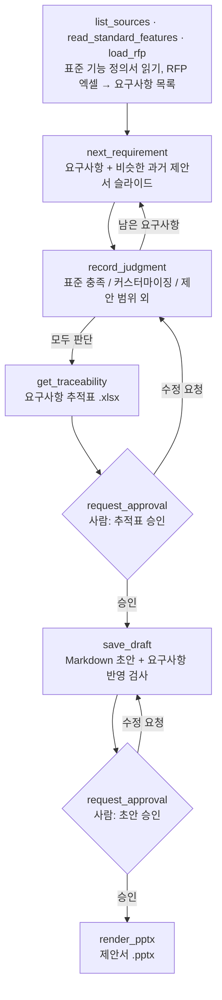

# proposal-mcp · RFP 기반 제안서 자동화 MCP 서버

B2B 솔루션 회사에서 신규 프로젝트마다 반복되는 일을 MCP 서버로 만들었습니다.

> 고객사 RFP를 받으면 → 요구사항마다 **우리 솔루션의 표준 기능으로 되는지, 커스터마이징이 필요한지** 판단하고 → 과거 제안서를 참고해 → 제안서(PPT)를 만든다

LLM이 도구를 골라 쓰며(Tool Calling) 이 순서를 진행하고, **되돌리기 어려운 단계는 사람이 승인해야만** 넘어갑니다.

## 흐름



참고 폴더 세 개를 읽습니다.

| 폴더 | 내용 | 형식 |
|---|---|---|
| `rfp/` | 이번 고객의 요구사항 정의서 | xlsx |
| `standard_features/` | 솔루션 표준 기능 정의서 (사람이 자연어로 쓴 문서, `##` 소제목이 기능 단위) | md |
| `past_proposals/` | 기존 제안서 (슬라이드 단위로 검색) | pptx |

## 설계에서 중요하게 본 것

**1. 판단은 LLM이 문서를 읽고, 검증은 서버가**
- 표준 기능 정의서는 개발팀이 평소 쓰는 말투의 Markdown입니다. "결재는 포털 안에서만 이뤄집니다"처럼 제약이 문장 속에 들어 있습니다.
  - 이런 문서는 키워드 검색으로 후보를 뽑기보다, **모델이 전체를 읽고** 판단하는 편이 정확합니다.
  - 정의서 한 개는 수십 쪽 이내라 컨텍스트에 그대로 들어갑니다.
- 기능 ID가 없는 자연어 문서이므로, 서버는 근거를 **소제목과 원문 인용**으로 검증합니다.
  - 근거로 든 `##` 소제목이 정의서에 실제로 있어야 합니다.
  - 인용한 문장이 그 소제목 아래에 **원문 그대로** 있어야 합니다(공백 차이만 허용). 지어낸 근거는 저장되지 않습니다.
  - `standard`·`custom`에는 근거가 필수이고, `custom`에는 추가 개발 범위가 필수입니다.
  - 과거 제안서 근거는 실제로 있는 슬라이드여야 합니다.

**2. 커스터마이징 판단은 사람이 반드시 확인**
- 제안서 본문에는 커스터마이징을 따로 표기하지 않습니다.
- 하지만 견적과 일정은 커스터마이징 목록으로 정해집니다. 그래서 초안을 쓰기 전에 추적표 승인을 받게 했습니다.

**3. 승인은 프롬프트가 아니라 서버 규칙으로 강제**
- 승인 요청은 MCP **elicitation**으로 사람에게 직접 갑니다. LLM은 승인을 대신할 수 없습니다.
- 승인은 "승인 당시 내용의 해시"로 기록합니다. 승인 뒤에 판단이나 초안이 바뀌면 승인이 자동으로 풀립니다.
- elicitation을 지원하지 않는 클라이언트에서는 사람이 터미널에서 `npm run approve`로 승인합니다.

**4. 초안의 요구사항 반영을 기계적으로 검사**
- 슬라이드마다 `<!-- req: SFR-001 -->`로 다루는 요구사항을 표시합니다. 이 표시는 PPT에서 지워집니다.
- 다음 경우에는 저장을 거절합니다.
  - 제안 범위 외가 아닌 요구사항이 빠진 경우
  - 범위 외 요구사항을 넣은 경우

**5. 순서는 MCP prompt로 제공**
- `create_proposal` prompt에 진행 순서와 판단 기준이 들어 있습니다.
- 어떤 MCP 클라이언트·모델을 붙여도 같은 순서로 진행합니다.

## 샘플 데이터
샘플은 모두 **가상**입니다.
- 고객사: 한빛캐피탈
- 솔루션: DataLens 데이터포털
- 기존 제안서: 새봄은행, 한결생명

요구사항 14건에는 판단이 갈리는 경우를 섞었습니다. `samples/expected_judgments.json`에 사람이 판단한 정답(표준 9 · 커스터마이징 3 · 범위 외 2)이 있습니다.

| 예시 | 요구사항 | 정의서의 문장 | 정답 |
|---|---|---|---|
| SFR-005 | 그룹웨어 전자결재로 승인 | "결재는 포털 안에서만 이뤄집니다." | 커스터마이징 (과거 새봄은행 구축 사례 있음) |
| SFR-009 | 품질 이상 1분 이내 실시간 감지 | "분 단위의 실시간 감시는 하지 않습니다." | 제안 범위 외 |
| SFR-003 | 인터넷 없이 자연어 검색 | "인터넷이 안 되는 폐쇄망에서도 동작합니다." (옵션 모듈) | 표준 충족 (옵션) |

## 실행

```bash
npm install
npm test            # MCP 클라이언트로 서버를 띄워 검증 규칙 확인
node test/e2e.ts    # 판단 → 승인 → 초안 → 승인 → PPT 전체 흐름 확인
```

Claude Code에서 이 폴더를 열면 `.mcp.json`으로 서버가 연결됩니다. `/mcp__proposal__create_proposal` prompt로 시작합니다. Claude 데스크탑 앱의 Code 탭도 같습니다.

환경 변수:
- `PROPOSAL_ROOT`: 참고 폴더 위치 (기본 `samples/`)
- `PROPOSAL_WORKSPACE`: 진행 상태와 결과물 위치 (기본 `workspace/`)

## 실행 결과 (Claude, 샘플 RFP 14건)
- 판단은 정답과 14건 모두 일치했습니다 (표준 9 · 커스터마이징 3 · 제안 범위 외 2). 인용 검증과 커버리지 검사를 한 번에 통과했고, 승인은 CLI로 진행했습니다.
- 초안에서는 출처에 없는 약속(오픈 후 상주 지원, 교육·매뉴얼 제공)이 나왔습니다. 판단과 달리 초안 문장은 서버가 검증하지 않기 때문입니다. 근거가 없으면 `[확인 필요]`로 남기도록 프롬프트를 고쳤고, 문장 단위 근거 검증은 다음 단계입니다.

## 한계와 다음 단계
- **정의서가 아주 커지면** 전체를 읽는 방식이 컨텍스트 한도에 걸립니다. 그때는 소제목 단위로 관련 부분만 골라 주는 검색이 필요합니다.
- **과거 제안서 검색은 BM25 키워드 검색만 있습니다.** 한국어 조사 때문에 2글자 단위로 자릅니다. 표현만 다른 슬라이드를 놓칠 수 있어, 벡터 검색을 RRF로 합치는 것이 다음 단계입니다 (`src/sources.ts`의 `index`).
- **모델별 비교는 아직입니다.** 같은 RFP로 모델마다 정답 일치율을 비교하는 평가는 로컬 모델 환경에서 진행할 예정입니다.
- **PPT는 제목·글머리표만 만듭니다.** 회사 템플릿 적용은 하지 않습니다.
- **RFP 형식은 엑셀만 지원합니다.** 실제로는 Word·PPT·HWP로도 옵니다.

## 구성

```
src/server.ts    MCP 도구 9개 + prompt 1개
src/sources.ts   RFP(xlsx)·기존 제안서(pptx)·표준 기능 정의서(md) 읽기, BM25 검색
src/state.ts     진행 상태, 승인 해시, 추적표, 요구사항 반영 검사
src/render.ts    Markdown 초안 → PPTX
src/approve.ts   터미널 승인 (elicitation 미지원 클라이언트용)
```

TypeScript를 Node.js 22.18+에서 빌드 없이 실행합니다. 실무에서 반복되던 제안서 작업을 바탕으로 문제와 핵심 요구(표준·커스터마이징 판단 루프, 사람 승인 구조)를 직접 정의했고, 설계와 구현은 Claude Code와 함께 진행했습니다.
